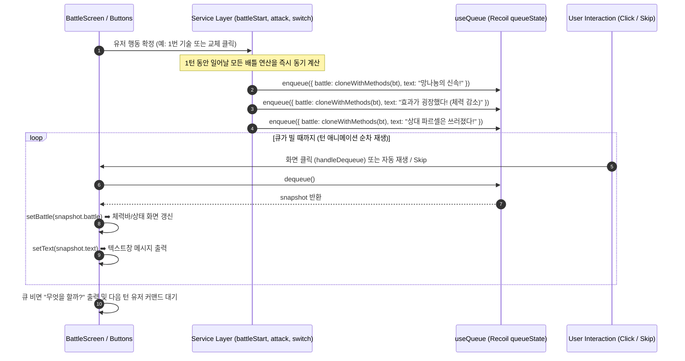
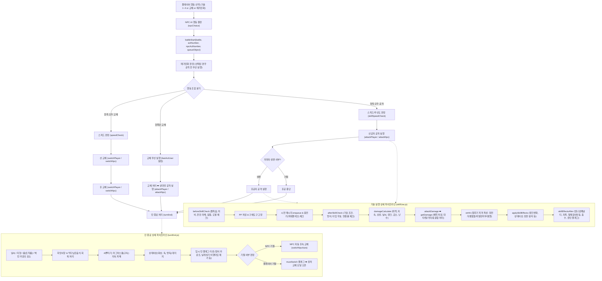

# 🎮 Pokemon Battle Simulator - 전체 아키텍처 & 플로우 가이드 (ARCHITECTURE.md)

이 문서는 본 프로젝트의 **화면 구성(UI)**, **전체 게임 플로우(Game Flow)**, **핵심 상태 관리(Queue System)**, **배틀 서비스 파이프라인**, **인공지능(AI Engine)**, 그리고 **각 코드 및 엔티티 간의 상관관계(Dependency & Call Graph)**를 한눈에 파악하고 개발/유지보수/디버깅 시 즉시 참조할 수 있도록 전수 조사하여 정리한 시스템 설계 문서입니다.

---

## 1. 📌 시스템 개요 및 기술 스택

- **프로젝트 성격**: 6세대~9세대 룰 기반의 포켓몬스터 3v3 싱글 배틀 시뮬레이터 (웹 기반 턴제 RPG)
- **주요 기술 스택**:
  - **Core**: React 18 (Create React App), JavaScript (ES6+ / Modern JS)
  - **State Management**: Recoil (`queueState`, `logState`, `gameOptionState` 등)
  - **Styling**: `styled-components`, CSS Keyframe Animations
  - **Routing**: `react-router-dom` (v7) (`basename: "pokemon"`)
  - **Testing**: Jest (`src/test/` 하위 단위 테스트 및 통합 테스트)

---

## 2. 🖥️ 화면 구성 및 라우팅 구조 (Screens & Routes)

`src/App.js`를 통해 3개의 핵심 화면으로 라우팅됩니다:

```
[App.js] (RecoilRoot, Router basename="pokemon")
  ├── [/]       MainScreen   (메인 로비: 빠른 시작, 커스텀 엔트리 진입, 설정, QR 연결)
  ├── [/custom] CustomScreen (팀 빌더: 샘플 조회/필터, 8종 모달, 개체값/노력치/기술/특성/도구 커스텀)
  └── [/battle] BattleScreen (메인 3v3 배틀: 상단 필드 뷰 + 하단 커맨드 패널)
```

### 1) MainScreen (`src/screen/MainScreen.js`)
- **역할**: 게임의 로비 화면.
- **기능**:
  - **빠른 시작 (Quick Start)**: `getRandomTeam(3)`을 통해 밸런스 잡힌 랜덤 3v3 팀을 생성하여 즉시 `/battle`로 이동.
  - **커스텀 배틀 시작**: 플레이어/NPC 팀을 직접 구성하는 `/custom` 화면으로 이동.
  - **테스트 모드 토글**: 테스트 모드 활성화 시 배틀 화면에서 NPC 행동 수동 지정 및 데미지 로그 상세 출력 지원.
  - **모바일 연동 QR 코드**: 로컬 IP(`/__local_ip`)를 조회하여 모바일 기기에서 동일 네트워크로 접속할 수 있는 QR 코드 제공.
  - **게임 옵션 모달 (`GameOptionModal`)**: 난이도 (이지/노말/하드), 팀 구성 옵션 (동일 포켓몬 허용 등) 설정 및 `localStorage` 영구 저장.

### 2) CustomScreen (`src/screen/CustomScreen.js`)
- **역할**: 3v3 엔트리 포켓몬을 자유롭게 빌드하고 팀을 관리하는 샌드박스 화면.
- **주요 모달 컴포넌트 (8종)**:
  1. `SampleInfoModal`: 선택한 포켓몬의 상세 정보 조회, 운용 팁(`[TIP]`) 표시, 각 항목 클릭 시 세부 설정 모달 오픈.
  2. `StatAdjustmentModal`: 개체값(6V, 5V0A, 4V0A0S 등), 노력치(252/252/4 배분), 성격 보정 설정 및 6각형 레이더 차트 시각화.
  3. `SkillSearchModal`: 포켓몬이 배울 수 있는 기술 목록 검색, 기술 4개 필수 선택 검증, 위력/명중과 순수 효과(`originText`) 분리 렌더링.
  4. `ItemSearchModal`: 배틀 도구 검색, 도구별 효과 설명 및 구현 여부 뱃지 표시.
  5. `AbilSearchModal`: 변경 가능한 특성 목록 검색, 구현 여부 뱃지 및 우선 정렬.
  6. `FilterModal`: 타입(OR/AND 로직 스위치 지원), 역할군(물리어태커/특수막이 등), 기타(메가진화, 초전설, 위협, 날씨, 벽깔이) 필터링.
  7. `EntrySaveModal` / `EntryLoadModal`: 구성한 팀 엔트리를 JSON 파일로 다운로드/업로드하여 로컬 파일 시스템과 연동.
  8. `GameOptionModal`: 배틀 난이도 및 룰 설정.

### 3) BattleScreen (`src/screen/BattleScreen.js`)
- **역할**: 닌텐도 2DS/3DS 스타일의 2분할 배틀 뷰.
- **상단 필드 (TOP: 43vh)**:
  - `PokemonImage`: 아군/적군 포켓몬 스프라이트 애니메이션, 상태이상 흔들림/피격 연출.
  - `ItemImage`: 장착 아이템 아이콘 및 툴팁.
  - `PokemonInfo` & `HpBar`: 포켓몬 이름, 레벨, 남은 체력 수치, 체력바 색상 변동(녹/황/적), 랭크 변동 뱃지(+1~+6 / -1~-6), 상태이상(화상, 마비, 독, 얼음, 잠듦) 뱃지.
- **하단 커맨드 패널 (BOTTOM: 57vh)**:
  - `bottom === "skill"`: 4개 기술 버튼(`SkillButton`), 상대 방어 상성 힌트(`◎ 굉장함`, `○ 보통`, `△ 별로`, `✕ 없음`), 메가진화 트리거 버튼, 상단/하단 조작 버튼(스킵, 로그, 교체, 정보, 필드).
  - `bottom === "switch"`: 수동 교체 선택창 (`BenchPokemon` 3마리의 체력/상태이상/기절 여부).
  - `bottom === "mustSwitch"`: 기절 후 강제 교체 선택창.
  - `bottom === "uturn"`: 유턴/볼트체인지/퀵턴 명중 후 교체 선택창.
  - `bottom === "info"`: 현재 출전 포켓몬의 상세 스탯, 성격, 특성, 기술 상세 정보 조회.
  - `bottom === "field"`: 날씨(턴수), 지형(턴수), 룸(트릭룸), 아군/적군 벽 및 장판(스텔스록, 압정 등) 현황.
  - `LogModal`: 턴별로 기록된 전체 텍스트 로그 조회.
  - `TradeInfoModal`: 교체 대상 선택 시 상성 및 스탯 비교 모달.

---

## 3. 🔄 핵심 아키텍처: 스냅샷 큐(Snapshot Queue) 시스템

비동기 React 웹 환경에서 턴제 콘솔 게임 특유의 **"메시지 출력 ➡️ 체력바 차감 ➡️ 기절 판정 ➡️ 후속 연출"** 흐름을 구현하기 위해 **이벤트 스냅샷 큐** 패턴을 사용합니다.



### 주요 원리
1. **`cloneWithMethods.js`**:
   - `JSON.parse(JSON.stringify(obj))`는 클래스 프로토타입과 메서드(`rankUp`, `getDamage`, `recover`, `megaEvolve` 등)를 유실시킵니다.
   - `cloneWithMethods`는 프로토타입 체인을 온전히 복사하여, 스냅샷 시점의 상태를 완벽히 격리하면서도 포켓몬의 모든 메서드가 정상 동작하도록 보장합니다.
2. **`textFreeze`**:
   - `"누구로 교체할까?"`, `"무엇을 할까?"` 등 사용자 인터랙션이 필요한 프롬프트 상태에서는 화면 클릭으로 큐가 임의로 넘어가지 않도록 방어합니다.
3. **`textSkip`**:
   - 사용자가 스킵 버튼을 누르면 큐의 모든 중간 텍스트를 건너뛰고 큐의 맨 마지막 스냅샷(최종 상태)으로 즉시 갱신합니다.

---

## 4. ⚔️ 배틀 턴 라이프사이클 (Full Battle Lifecycle Flow)

전체 1턴의 실행 흐름과 서비스 레이어의 호출 순서는 다음과 같습니다:



---

## 5. 🧠 인공지능 (AI Engine) 아키텍처

AI는 `src/npc/` 디렉토리에 위치하며, 배틀 상황을 실시간 분석하여 최적의 기술 또는 교체 행동을 결정합니다.

```
src/npc/
├── npc.js                # NPC 행동 결정 엔트리 (유효 선택지 추출 및 모드 분기)
└── ai/
    ├── easy.js           # 5단계 킬각 판정 및 교체 점수 산출
    ├── calculateSkillScore.js # 공격/변화기 종합 가중치 스코어링 공식
    └── random.js         # 완전 무작위 선택기
```

### 1) 킬각 판정 5단계 결정 계층 (`getKillableSkill` in `easy.js`)
상대방을 확정 또는 최대 난수로 쓰러뜨릴 수 있는 기술군 중에서 아래 순서로 단계를 좁혀 최적의 기술을 선택합니다:

```
[후보 기술군 추출: minDmg >= 상대 HP (확정 킬) 또는 maxDmg >= 상대 HP (난수 킬)]
   │
   ▼ 1단계: 우선도 (Priority)
   최고 우선도 기술군 선택 (예: 선공기 +2, +1 > 일반 기술 0)
   │
   ▼ 2단계: 강한 디메리트 없음 (No Strong Demerit)
   자폭, 반동휴식, 특공2랭다운 등 치명적인 기술을 배제 (단, 후보군 전체가 해당 기술뿐이면 유지)
   │
   ▼ 3단계: 명중률 (Accuracy)
   최고 명중률 기술군 선택 (필중 9999 > 100% > 90% > 70%)
   │
   ▼ 4단계: 약한 디메리트 없음 (No Weak Demerit)
   반동, 빗나감패널티, 내구 1랭크다운 등 약한 디메리트가 없는 기술을 우선 선택
   │
   ▼ 5단계: 데미지 (Damage)
   모든 조건이 동률일 때 최소 데미지(minDmg)가 가장 높은 기술 최종 선택!
```

### 2) 디메리트 정밀 분류 체계
- **🔴 강한 디메리트 (`hasStrongDemerit`)**:
  - 단순 효과 (배열 순회): `자폭`, `대폭발` (즉시 기절), `반동휴식` (다음 턴 행동 불가: 파괴광선 등), `철제광선반동` (최대 HP 50% 소모), `자동` (역린 등 2~3턴 행동 고정 후 혼란).
  - 조건부 효과:
    - `공격 OR 특공 2랭크 이상 하락`: 용성군, 오버히트, 리프스톰.
    - `화상치료`: 상대방이 `물리어태커` 또는 `물리딜탱`이고 실제로 `화상` 상태일 때만 강한 디메리트.
- **🟡 약한 디메리트 (`hasWeakDemerit`)**:
  - 단순 효과 (배열 순회): `빗나감패널티` (무릎차기, 썬더다이브: 빗나갈 시 HP 50% 반동).
  - 조건부 효과:
    - `반동`: 브레이브버드, 플레어드라이브, 양날박치기 등 (단, 특성이 `"돌머리"`인 경우 디메리트 제외).
    - `자신 대상 랭크 하락`: 인파이트, 엄청난힘, 암해머, 스케일샷 등 (방어/특방/스피드 1랭크 하락).
    - `2회 연속 사용 불가`: 블러드문 (`feature.noDouble`).

### 3) 가중치 스코어링 엔진 (`calculateSkillScore.js`)
- **공격기**:
  - `damageCalculate(..., { randNum: 92 })`로 평균 데미지 산출.
  - 확정급소(`mustCritical`) 기술은 `damageCalculate` 내에서 급소(1.5배 및 상대 랭크업/자신 랭크다운 무시)가 자동 반영됨.
  - 기본 점수 = `(avrDmg * accur) / playerHp`
  - 급소율 증가 기술 보정 (`score *= 1.05`), 반동기 보정 (`score *= 0.9`, 돌머리 제외), 반동휴식 보정 (`score *= 0.3`).
- **희생기 / 퇴장기 완만도 곡선 (`getLowHpFactor`)**:
  - `초승달춤`, `치유소원`: `Math.round(230 * (1 - hp/maxHp)^2.3)` (남은 벤치가 없으면 불발 -999).
  - `자폭`, `대폭발`: `0.15 + 0.95 * factor`.
  - `철제광선반동`: `0.7 + 0.35 * factor`.
- **변화기 / 유틸기**:
  - 상태이상(화상, 마비, 독, 혼란, 풀죽음), 랭크업/다운, 탁쳐서떨구기(상대 아이템 가치 비례), 벽 파괴, 장판(스텔스록/독압정/압정/끈넷: 상대 남은 포켓몬 수 비례), 클리어스모그, 트릭 등 복합 가중치 반영.

---

## 6. 🧬 도메인 엔티티 & 데이터 모델 (`src/entity/`)

```
src/entity/
├── Battle.js               # Battle 객체 루트 (턴 상태, 필드, 진영 정보 관리)
├── Ability.js              # 특성 DB 및 등장 특성 실행기 (applyAbilityEffects)
├── Item.js                 # 도구 DB, 분류 및 AI 도구 가치 점수표 (aiItemScore)
├── Pokemon/                # 포켓몬 관련 핵심 도메인 모델
│   ├── PokemonData.js      # 기본 도감 데이터 (종족값, 타입, 특성 목록)
│   ├── PokemonTemplate.js  # 샘플 템플릿 (개체값, 노력치, 성격, 기술4종, 도구, 특성, 팁)
│   ├── SamplePokemon.js    # 게임 프리셋 샘플 목록 (단일 인스턴스 sampleList)
│   ├── PokemonInstance.js  # 런타임 배틀 포켓몬 인스턴스 (HP, 스탯, 랭크, 상태이상)
│   ├── MegaData.js         # 메가진화 폼 데이터 (스탯/타입/특성 변화치)
│   └── Methods/            # PokemonInstance 프로토타입 확장 메서드 분리
│       ├── PokemonRank.js      # rankUp, rankDown, rankUpMulti
│       ├── PokemonGetDamage.js # getDamage (체력 차감 및 로그 기록)
│       ├── PokemonRecover.js   # recover (회복 처리)
│       ├── PokemonMega.js      # megaEvolution, isMegaEvolveAble
│       └── PokemonAbil.js      # isFlying 등 특성/타입 판정 헬퍼
├── Skill/                  # 기술 관련 핵심 도메인 모델
│   ├── Skill.js            # Skill 클래스 (위력, 명중, PP, 우선도, originText 등)
│   ├── SkillEffect.js      # 40여 종의 부가효과 실행기 (skillEffectSearch)
│   ├── SkillRequirement.js # 기술 발동 전제조건 검사기
│   ├── skillList.js        # 전체 기술 싱글턴 목록 (skillList)
│   └── skillList/          # 물리(atk), 특수(catk), 변화(natk, buf) 세부 기술 정의
└── Field/                  # 배틀 필드 환경 도메인 모델
    ├── Field.js            # Field 루트 객체
    ├── Weather.js          # 날씨 (쾌청, 비, 모래바람, 눈/설경)
    ├── Terrain.js          # 필드 지형 (일렉트릭, 그래스, 미스트, 사이코)
    ├── Room.js             # 트릭룸
    └── UserField.js        # 진영별 상태 (리플렉터, 빛의장막, 스텔스록, 압정 등)
```

---

## 7. 🛠️ 유틸리티 및 연산 계층 (`src/util/` & `src/function/`)

| 파일명 | 위치 | 책임 및 핵심 로직 |
| :--- | :--- | :--- |
| **`damageCalculate.js`** | `src/util/` | 본가 6~9세대 데미지 공식 완벽 구현. 기초 스탯, 랭크 배율(천진/급소/성칼), 도구(생구/구애/돌조/휘석), 특성, 날씨, 자속, 타입상성, 벽, 화상, 급소, 85~100% 난수 연산. `ai` 모드 지원. |
| **`typeEffectCalculate.js`** | `src/util/` | 18개 타입 상성 매트릭스. 부유, 풍선, 심안 특성 등을 조합하여 최종 배율(0, 0.25, 0.5, 1, 2, 4배) 계산. |
| **`speedCheck.js`** | `src/util/` | 스탯, 마비, 순풍, 랭크, 아이템(구애스카프) 기반 실시간 스피드 계산. `skillSpeedCheck`, `priCalculate`, `megaSpeedCheck` 제공. |
| **`cloneWithMethods.js`** | `src/util/` | 객체의 프로토타입 체인과 메서드를 완벽히 유지하는 커스텀 깊은 복사 함수 (스냅샷 큐의 기반). |
| **`useQueue.js`** | `src/util/` | Recoil `queueState`를 다루는 커스텀 훅 (`enqueue`, `dequeue`, `resetQueue`, `textSkip`). |
| **`customEntryUtil.js`** | `src/util/` | 커스텀 엔트리 유효성 검증, 이름/타입/역할군 필터링, JSON 파일 저장/로드 처리. |
| **`randomTeam.js`** | `src/util/` | 밸런스 잡힌 3v3 랜덤 팀 생성기 (역할군 및 타입 중복 분산 룰 적용). |
| **`damage.js`** | `src/function/` | `attackDamage`: 실 체력 차감, 대타출동, 탈(Disguise), 기합의띠, 옹골참 방어 메커니즘 처리. |
| **`rankStat.js`** | `src/function/` | 랭크 수치(-6 ~ +6)에 따른 본가 스탯 승수 매핑 (`2/8` ~ `8/2`). |
| **`ailment.js`** | `src/function/` | 상태이상 부여 가능 여부 검사(`ailmentAbleCheck`) 및 상태이상 적용(`applyAilment`). |
| **`accuracyCalculate.js`** | `src/function/` | 날씨(비 번개/폭풍 필중, 쾌청 50%), 복안 특성(1.3배) 등이 반영된 최종 명중률 산출. |
| **`switchPokemon.js`** | `src/function/` | 배틀 인스턴스 내 출전 포켓몬과 벤치 포켓몬의 스왑 연산. |

---

## 8. 📊 모듈 간 호출 및 의존성 관계 매트릭스 (Call & Dependency Graph)

```
[UI Layer]
  BattleScreen ───► battleStart.js ───► attack.js ───► skillUse.js
        │                  │              │                │
        │                  │              │                ├──► damageCalculate.js ──► typeEffectCalculate.js
        │                  │              │                ├──► damage.js (attackDamage)
        │                  │              │                ├──► onHit.js
        │                  │              │                ├──► skillCheck.js
        │                  │              │                └──► skillEffect.js ──► SkillEffect.js
        │                  │              │
        │                  │              └──► switch.js ──► Ability.js (applyAbilityEffects)
        │                  │                         └──► field.js (장판 데미지)
        │                  │
        │                  └──► turnEnd.js ──► ailmentEvent.js / skillEvent.js
        │
        ├──► useQueue.js ──► Recoil (queueState, logState)
        │
        └──► npc.js ──► easy.js ──► calculateSkillScore.js ──► damageCalculate.js
                              └──► getKillableSkill
```

| 호출 주체 (Caller) | 호출 대상 (Callee / Dependencies) | 연동 목적 및 데이터 흐름 |
| :--- | :--- | :--- |
| **`BattleScreen`** | `battleStart.js`, `switch.js`, `useQueue.js`, `npc.js` | 유저의 행동 입력을 받아 턴을 개시하고, 생성된 큐 스냅샷을 구독하여 UI 렌더링 |
| **`battleStart.js`** | `speedCheck.js`, `attack.js`, `switch.js`, `turnEnd.js`, `PokemonMega.js` | 턴 시작 시 행동 우선권 및 메가진화를 처리하고 공격/교체/턴종료 파이프라인 조율 |
| **`attack.js`** | `skillUse.js` | 턴 내 공격자/피격자 관점을 설정하고 기술 시전 함수 위임 |
| **`skillUse.js`** | `skillCheck.js`, `damageCalculate.js`, `damage.js`, `onHit.js`, `skillEffect.js` | 시전 검사부터 데미지 차감, 접촉기 특성, 부가효과까지 1회 공격의 전 과정 오케스트레이션 |
| **`damageCalculate.js`** | `typeEffectCalculate.js`, `rankStat.js`, `speedCheck.js` | 공격자 스탯, 방어자 스탯, 랭크, 아이템, 특성, 상성을 종합하여 순수 데미지 계산 |
| **`switch.js`** | `switchPokemon.js`, `Ability.js`, `field.js` | 포켓몬 교체 스왑, 등장 특성(위협/날씨 등) 발동, 스텔스록 등 장판 피해 적용 |
| **`turnEnd.js`** | `ailmentEvent.js`, `skillEvent.js`, `switch.js` | 턴 마무리 시 날씨/상태이상 피해, 지속 회복 연산 및 기절 시 후속 교체 트리거 |
| **`npc.js`** | `easy.js`, `random.js` | NPC AI 모드에 따라 유효 선택지 중 최종 행동 1종 결정 |
| **`easy.js`** | `calculateSkillScore.js`, `damageCalculate.js`, `speedCheck.js` | 5단계 킬각 판정(`getKillableSkill`) 및 교체 점수 산출(`calculatePokemonSwitchScore`) |
| **`calculateSkillScore.js`** | `damageCalculate.js`, `accuracyCalculate.js`, `easy.js` | 공격/변화기 종합 가중치 점수 산출 및 `getLowHpFactor` 희생기 곡선 계산 |
| **`CustomScreen`** | `customEntryUtil.js`, `SamplePokemon.js`, `Battle.js` | 포켓몬 데이터 필터링, 모달을 통한 커스텀 파라미터 조합 및 `createBattle` 전달 |

---

## 9. 🛠️ 개발 시 필수 가이드라인 및 주의사항 (Cheat Sheet)

1. **테스트 코드 작성 규칙 (`GEMINI.md`)**:
   - 모든 test 코드는 **맨 위에 실행 명령어를 주석으로 작성**해야 합니다.  
     *(예: `// npm test -- src/test/ai/killableSkill.test.js`)*
2. **코드 수정 시 주석 보존 (`GEMINI.md`)**:
   - 기존 코드에 작성된 주석 및 기획 의도 설명은 최대한 보존합니다.
3. **스냅샷 큐 불변성 준수**:
   - `queueObject.enqueue`를 호출할 때는 반드시 `cloneWithMethods(battle)`를 사용하여 객체 프로토타입 메서드가 보존된 깊은 복사본을 전달해야 합니다.
4. **AI 데미지 계산 시 급소 원칙**:
   - `damageCalculate(..., ai)` 호출 시 일반 기술은 급소가 무조건 제외되며, `mustCritical` 확정급소 기술만 1.5배 및 랭크 무시가 자동 적용됩니다.
5. **유턴 / 볼트체인지 흐름**:
   - 공격 후 `battle.turn.uturn = true`가 되며, UI가 `bottom === "uturn"` 화면으로 전환되어 유저가 교체 대상을 골라야 다음 턴 진행이 연결됩니다.
6. **동시 기절 (Double Faint)**:
   - 양측 포켓몬 동시 기절 시 플레이어가 먼저 `mustSwitch`로 후속 포켓몬을 선택한 후, NPC 후속 교체(`switchNpcAuto`)가 순차 호출되어야 합니다.
