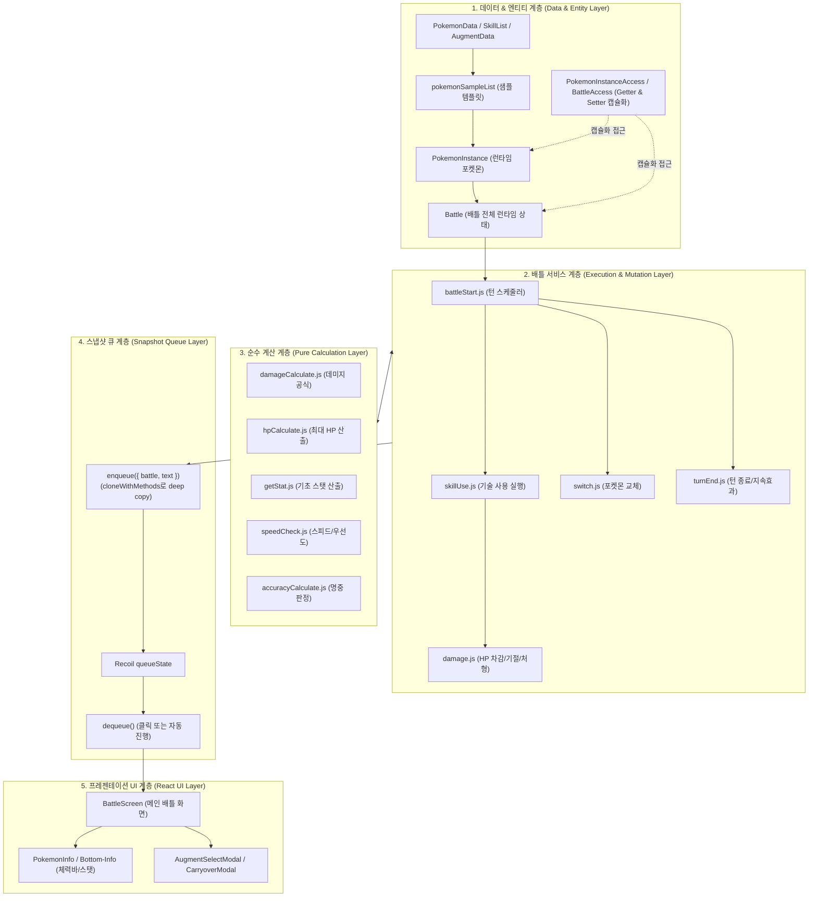
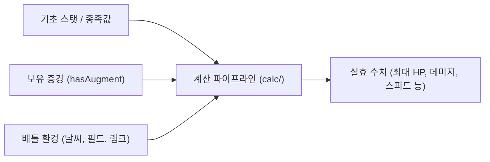
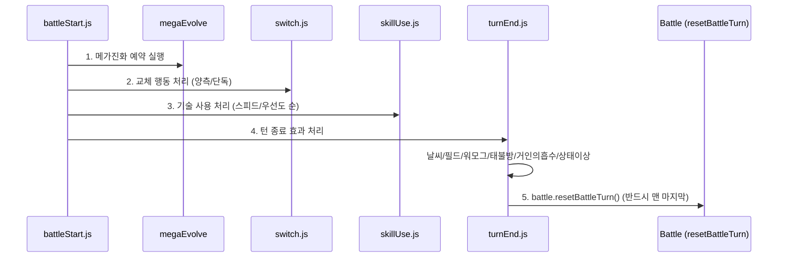

# 🤖 Pokemon Battle Simulator - AI 개발자용 코드베이스 아키텍처 레퍼런스 (`ARCHITECTURE.md`)

> **이 문서의 목적**: 생성형 AI 코딩 에이전트가 기능 추가·버그 수정·리팩토링 요청을 받았을 때, **전체 파일을 뒤지지 않고도 수정 대상 파일, 데이터 불변성 규칙, 수치 계산 파이프라인, 스냅샷 타이밍, 직렬화 지점**을 즉시 파악할 수 있도록 설계된 레퍼런스 문서입니다.

---

## 0. 📜 핵심 개발 원칙 (Core Development Principles)

모든 개발 및 코드 수정 시 아래 원칙을 반드시 준수해야 합니다:

### 1. `PokemonInstance` 및 `Battle` 내부 값에 직접 접근하지 말고, `PokemonInstanceAccess`와 `BattleAccess`에 getter와 setter를 선언하여 접근 및 수정한다
- 포켓몬 인스턴스(`PokemonInstance`) 및 배틀(`Battle`) 내부의 프로퍼티에 외부 파일(`service`, `calc`, `component`, `npc`, `screen` 등)에서 직접 접근(`p.o.xxx` 또는 `battle.field.xxx` 등)하여 값을 읽거나 변경하지 않는다.
- 데이터 조회 및 변경은 반드시 `PokemonInstanceAccess.js`와 `BattleAccess.js`에 명시적으로 선언된 getter와 setter를 통해서만 수행하여 캡슐화와 데이터 무결성을 보장한다.

```javascript
// ❌ Bad (내부 프로퍼티 직접 침범 및 수정)
const skill = pokemon.o.skill;
const isSunny = battle.field?.weather?.isSunny?.(battle);
pokemon.o.megaData.abil = newAbil;

// ⭕ Good (Access 계층의 getter/setter 사용)
const skill = pokemon.skill;       // PokemonInstanceAccess getter
const isSunny = battle.isSunny;    // BattleAccess getter
pokemon.megaAbil = newAbil;        // PokemonInstanceAccess setter
```

---

### 2. 코드는 필요한 코드만 간결하게 작성한다
- **2-1. 과도한 다중 조건문 금지**: "혹시 몰라서" 조건문을 여러 겹으로 엮지 않는다. 코드를 분석하여 런타임에 보장된 정확한 단일 값만을 조건에 사용한다.
```javascript
// ❌ Bad (혹시 몰라 여러 경로를 중복해서 검사)
if (pokemon.abil?.name === "가뭄" || pokemon.abil === "가뭄" || pokemon.o?.abil === "가뭄" || pokemon.o?.abil?.name === "가뭄")

// ⭕ Good (정확히 필요한 단일 값만 사용)
if (pokemon.abil.name === "가뭄")
```
- **2-2. 사용하지 않는 함수를 미리 작성하지 않는다 (YAGNI)**: 새로운 객체나 모듈을 구현할 때 "나중에 쓸 것 같다"는 추측으로 미리 함수를 작성해놓지 않는다. 모든 함수는 실제로 해당 기능이 필요해지는 시점에 구현한다.
```javascript
// ❌ Bad (실제 호출부가 없는 미래 대비용 메서드 사전 작성)
class PokemonSampleList {
  getDataByDexNo(dexNo) { ... } // 현재 코드베이스 어디에서도 쓰이지 않음
}

// ⭕ Good (실제 요구사항에 의해 호출되는 필수 메서드만 작성)
class PokemonSampleList {
  getDataBySampleName(name) { ... }
  getDataByUniqueKey(key) { ... }
}
```
- **2-3. 함수의 인자 타입 및 순서는 고정하여 사용한다**: 각 인자의 type에 따라 유동적으로 다르게 분기 처리(polymorphic argument)하지 않는다. 인자의 이름과 전달되는 값의 타입 및 순서를 명확하게 고정된 단일 시그니처로 유지한다.
```javascript
// ❌ Bad (인자 타입에 따라 유동적으로 다르게 처리)
function calculateHp(pokemonOrHp, optionsOrBattle) {
  if (typeof pokemonOrHp === "number") { ... }
  else if (pokemonOrHp.stat) { ... }
}

// ⭕ Good (명확하고 고정된 단일 타입 시그니처)
function hpCalculate(pokemon) {
  const baseHp = pokemon.baseHp;
  ...
}
```

---

### 3. `export`해서 밖에서 사용하지 않는 함수는 `export`로 지정하지 않는다
- 다른 파일에서 참조(`import`)하지 않는 함수는 불필요하게 `export`를 붙이지 않는다.
- 해당 파일 내부에서만 사용하는 작은 규모의 내부 함수는 파일 최대한 밑(최하단)에 작성하여 상단의 주요 로직 및 공개 인터페이스의 가독성을 보장한다.

```javascript
// ❌ Bad (내부 전용 헬퍼에 무분별한 export 남발 & 파일 상단 배치)
export function parseSpeedModifier(...) { ... } // 이 파일에서만 쓰임
export const speedCalculate = (pokemon, ...) => { ... };

// ⭕ Good (상단: 주요 공개 API / 하단: export 없는 순수 내부 헬퍼)
export const speedCalculate = (pokemon, ...) => {
  ...
  const modifier = parseSpeedModifier(pokemon);
};

// --- 내부 헬퍼 함수 (파일 하단에 작성, export 금지) ---
function parseSpeedModifier(pokemon) { ... }
```

---

### 4. 특정 함수나 변수명을 바꾸라 지시하였을 때 하위 호환용 래퍼 함수를 두지 말고 무조건 모든 호출부를 바꾼다
- 함수명이나 프로퍼티명을 변경할 때, 기존 코드가 깨질 것을 염려하여 이전 이름을 남겨두는 하위 호환용 래퍼 함수를 방치하지 않는다.
- 코드베이스 전체(`git grep`)를 전수 조사하여 모든 호출부를 새로운 표준 명칭으로 일괄 변경한다.

```javascript
// ❌ Bad (이전 이름 지원용 하위 호환 래퍼 방치)
getDataById(id) {
  return this.getPokemonDataByUniqueKey(id); // 기술 부채 누적
}

// ⭕ Good (래퍼 없이 모든 호출부를 직접 일괄 수정)
// 코드베이스 전체에서 getDataById(...)를 getPokemonDataByUniqueKey(...)로 일괄 치환
```

---

### 5. 옵셔널 체이닝(`?.`)을 최대한 사용하지 않는다
- `PokemonInstance`와 `Battle`은 생성자에서 모든 프로퍼티를 명시적으로 선언하고 `null`, `false`, `0`, 빈 객체 등으로 초기화해두고 있으므로 정상적인 인스턴스에서 특정 프로퍼티가 존재하지 않는 경우는 없다.
- 습관적으로 `?.`을 남발하면 오타나 구조적 결함 같은 런타임 오류가 조용히 `undefined`로 무마되어 디버깅과 에러 탐지 기회를 놓치게 된다. 필수 불가결한 경우를 제외하고는 직접 접근을 사용하여 오류 발생 시 즉시 발견되도록 한다.

```javascript
// ❌ Bad (과도한 ? 사용으로 프로퍼티 오타/버그 은폐)
const atkRank = pokemon?.tempStatus?.rank?.atk;
if (pokemon?.ailment?.burn) { ... }

// ⭕ Good (명확한 속성 접근 - 구조적 오류 즉각 탐지 가능)
const atkRank = pokemon.tempStatus.rank.atk;
if (pokemon.ailment.burn) { ... }
```

---

### 6. `PokemonInstance`나 `Battle`에 프로퍼티 추가 시 해당 파일에 해당 프로퍼티를 명시적으로 적어놓는다
- 즉, 해당 파일(`PokemonInstance.js` 또는 `Battle.js`)에 미리 적혀있지 않은 동적 프로퍼티를 외부 파일이나 런타임에서 함부로 선언/할당하지 않는다.
- 새로운 상태나 플래그가 필요하다면 반드시 해당 클래스의 생성자(`constructor`)에 기본값(`null`, `false`, `0` 등)과 설명을 명시적으로 선언해 둔 뒤 사용한다.

```javascript
// ❌ Bad (외부 파일에서 임의의 런타임 동적 프로퍼티 할당)
// someService.js
pokemon.myCustomTurnFlag = true; // PokemonInstance.js에 정의되어 있지 않음!

// ⭕ Good (PokemonInstance.js 생성자에 명시적 선언 후 사용)
// src/entity/Pokemon/PokemonInstance.js
class PokemonInstance {
  constructor(...) {
    ...
    this.myCustomTurnFlag = false; // [기능 설명] 신규 플래그 명시적 초기화
  }
}
```

---

### 7. 증강 판정은 최대한 `hasAugment`만을 사용한다
- 증강에 대한 조건문 판정을 위해 기술(`Skill`)이나 포켓몬 객체에 임의의 커스텀 플래그/프로퍼티(예: `isLostTechnologyHyperBeam` 등)를 추가하거나 `augments` 배열을 직접 순회하며 특정 아이디가 존재하는지 체크하지 않고, `pokemon.hasAugment("증강ID")`를 통해 직접 판정한다.

```javascript
// ❌ Bad (커스텀 플래그 주입 또는 배열 직접 순회)
if (skill.isLostTechnologyHyperBeam) { ... }
if (pokemon.augments?.some((a) => (typeof a === "string" ? a === "lifePartner" : a.id === "lifePartner"))) { ... }

// ⭕ Good (표준 hasAugment 메서드로 직접 판정)
if (pokemon.hasAugment("lostTechnologyHyperBeam")) { ... }
if (pokemon.hasAugment("lifePartner")) { ... }
```

---

## 1. 🏗️ 전체 시스템 아키텍처 및 데이터 흐름 (System Overview)

본 프로젝트는 **동기식 턴 배틀 시뮬레이션 엔진**과 **React 기반 프레젠테이션 UI**가 완전히 분리된 구조를 가집니다. 배틀 1턴의 모든 연산(공격, 교체, 상태이상, 증강 효과 등)은 동기 함수에서 즉시 계산되며, 계산 과정마다 상태 스냅샷이 큐(`queue`)에 적재되어 UI에서 순차적으로 재생됩니다.



---

## 2. 🧭 작업별 수정 위치 빠른 라우팅 테이블 (Task-to-File Routing)

특정 기능을 수정하거나 추가할 때 반드시 함께 확인·수정해야 하는 파일 목록입니다.

| 작업 유형 | 필수 수정 / 확인 파일 | 핵심 체크포인트 |
| :--- | :--- | :--- |
| **신규 증강(Augment) 추가** | 1. `src/entity/Augment/AugmentData.js` (`AUGMENT_LIST`, 필요 시 `AUGMENT_SYNERGY_MAP`, `SYNERGY_ACTIVATION_THRESHOLD`, `SYNERGY_INFO_MAP`)<br>2. `src/component/battleScreen/augment/AugmentIcon.js` (아이콘 SVG 또는 PNG `<image>`, 배경 원 제외 조건 `id !== "..."`)<br>3. 효과 발동처 (`damageCalculate.js` / `speedCheck.js` / `hpCalculate.js` / `getStat.js` / `turnEnd.js` / `onHit.js` / `damage.js` / `SkillEffect.js` / `skillUse.js` / `ailment.js` / `PokemonRecover.js` 등)<br>4. 신규 상태 프로퍼티 필요 시 `PokemonInstance.js` 및 `PokemonInstanceAccess.js` | - 상세 절차는 **[AUGMENT_ADD_GUIDE.md](file:///c:/Users/khs20/pokemon/public/txt/md/AUGMENT_ADD_GUIDE.md)** 참조.<br>- 증강 판정은 항상 `pokemon.hasAugment("id")` (팀 버프는 `pokemon.hasAugmentOnTeam("id", battle)`) 사용.<br>- 교체형 증강(`REPLACEMENT_AUGMENT_IDS`)은 우측 상단에 '교체' 배지 표시.<br>- 스택/상태를 가지는 증강이면 아래 **라운드 승계 직렬화 지점** 필수 수정. |
| **스택/상태형 증강 승계 추가** | 1. `src/entity/Pokemon/PokemonInstance.js` & `src/entity/Pokemon/Methods/PokemonAugment.js` (`checkAugmentSynergies`, `applyAugment`)<br>2. `src/entity/Augment/AugmentData.js` (`onApply`에서 `options` 복원, `statusModalText` / `getDesc` 표기)<br>3. `src/component/battleScreen/augment/AugmentCarryoverModal.js` (`carriedMap` 직렬화)<br>4. `src/store/battleStore.js` (`effectiveCarriedMap` → `serializedCarried` → 초기 `applyAugment` 호출 옵션) | `navigate("/battle", { state })`는 함수를 복제할 수 없으므로(`DataCloneError`), plain 객체(`serializedCarried`)에 상태 필드를 명시적으로 복사해야 다음 라운드로 전달됨. |
| **최대 HP 관련 로직 수정** | 1. `src/calc/hpCalculate.js`<br>2. `src/entity/Pokemon/Methods/PokemonInstanceAccess.js` (`maxHp` getter) | `pokemon.o.hp`를 직접 수정하지 말고 `hpCalculate(pokemon)` 내부에 합연산(`giantAbsorption`) 및 곱연산(`ironWall`, `hyperBody`, `growUp`, `praiseTheSun`) 규칙을 추가할 것. 배틀 내 최대 HP 조회는 모두 `p.maxHp`를 통함. |
| **공격/방어/특공/특방/스피드 스탯 증강 수정** | `src/calc/getStat.js` (`getAugmentedStat`, `getHighestStatInfo`) | 합연산(`arcaneShadeSword`, `swordEnhance`, `mejaisSoulstealer`, `soulDice`, `axeOfDespair`, `rush`, `powerOfKing`, `holyElfBlessing`, `salamandra`, `flamingKatana`, `sunfireCape`, 팀 버프 `haste`, `waterOmotics`, `giantSoldierOfStone`) → 곱연산(`lifePartner`, `soulMinion`, `jinanSangae`, `pokemonQuizExpert`, `rampagingPower`, `threeBearsHouse`, `rabadonsDeathcap`, `allOrNothing`, `allInDefense`, `limiterRemoval`, `dragonRoar`) → 팀 시너지(`echoOfHero`, `mapleWarrior`, `millenniumShield`) → 디버프(`armorBreak`) 순서로 계산됨. |
| **스피드/우선도 계산 수정** | `src/calc/speedCheck.js` (`speedCalculate`, `priCalculate`, `skillSpeedCheck`, `speedCheck`) | 메가진화 예상 스피드는 `getExpectedMegaSpeed`에서 가상 뷰(`megaPokemonView`)로 계산됨. `believeInMyself` 등 스피드 배율 적용 여부 확인. |
| **데미지 공식/배율 수정** | `src/calc/damageCalculate.js` (공식 산출), `src/service/damage/damage.js` (실제 체력 차감/기띠/옹골참/탈/대타/처형) | `damageCalculate`는 순수 계산(로그 기록 포함)만 수행하고, 실제 HP 감소·기절·열매·처형은 `damage.js`(`attackDamage`)와 `PokemonGetDamage.js`에서 수행함. |
| **상태이상 및 회복 로직 수정** | `src/service/ailment.js` (`ailmentAbleCheck`, `applyAilment`, `getBurnStack`), `src/entity/Pokemon/Methods/PokemonRecover.js` (`_doRecover`) | `sunBreathing` 화상 최대 13스택 중첩(`pokemon.ailment.burn = 1..13`) 및 2스택 이상 치유 70% 감소, `superheatedGladius` 화상 대상 추가 화상 시 최대 HP 10% 데미지 처리. |
| **턴 종료 효과 추가/수정** | `src/service/turnEnd.js` | **주의**: `battle.resetBattleTurn()`은 반드시 `turnEnd.js` 맨 마지막 줄에서 호출되어야 함. 워모그, 타오르는 천 개의 태양, 태불방, 거인의 흡수, 상태이상 데미지(태양 만세 회복 연동) 처리 순서 준수. |
| **기술(Skill) 추가/수정** | `src/entity/Skill/PokemonSkillList.js`, `src/entity/Skill/skillList/*.js`, `src/entity/Skill/SkillEffect.js`, `src/entity/Skill/SkillRequirement.js` | 공격 전 체크는 `src/service/skillCheck.js`, 명중 후 접촉 판정은 `src/service/onHit.js`, 부가효과는 `SkillEffect.js`에서 처리. |
| **특성(Ability) 추가/수정** | `src/entity/Ability.js` (`abilObject`, `noTraceAbil`, `noRandomAbil`, `applyAbilityEffects`) 및 `PokemonAbil.js` (`changeAbil`) | 공식 설명 텍스트 등록 필수. 등장 시 발동 특성은 `applyAbilityEffects`, 스킨류 특성은 `src/calc/skillTypeCalculate.js` & `damageCalculate.js` 연동. |
| **도구(Item) 추가/수정** | `src/entity/Item.js` (`itemText`, `noNullItem`), `src/component/customScreen/sampleInfo/ItemSearchModal.js` | **도구 이미지는 사용자가 직접 관리하므로 `public/img/item/` 디렉터리는 절대 수정하지 않는다.** |
| **NPC AI 판단 로직 수정** | `src/npc/npc.js`, `src/npc/ai/easy.js` (`getKillableSkill`, `calculatePokemonSwitchScore`), `src/npc/ai/calculateSkillScore.js` | AI가 데미지를 시뮬레이션할 때는 `damageCalculate(..., { ai: true, randNum })`를 사용하여 `pokemon.log` 오염 및 일반 급소 변수를 배제함. |

---

## 3. 🧬 `PokemonInstance` & `Battle` 상태 계층 및 Access 캡슐화 명세

런타임 포켓몬 객체(`src/entity/Pokemon/PokemonInstance.js`)와 배틀 객체(`src/entity/Battle.js`)는 상태의 수명(Lifecycle)에 따라 계층화되어 있으며, **외부 파일에서는 직접 내부 프로퍼티를 건드리지 않고 Access 계층의 getter/setter를 통해 접근**합니다.

### 3.1 캡슐화 계층 (`PokemonInstanceAccess.js` & `BattleAccess.js`)

- **원칙**: 외부 파일(`service/`, `calc/`, `component/`, `npc/`, `screen/`)에서 `pokemon.o.xxx` 또는 `battle.field.xxx`로 직접 접근하는 것을 금지합니다.
- **`PokemonInstanceAccess` 주요 Getter / Setter**:
  - `pokemon.sampleName`, `pokemon.dexNo`, `pokemon.uniqueKey`, `pokemon.id` (불변 식별자)
  - `pokemon.stat` (기본 스탯 객체: `{ atk, def, catk, cdef, speed }`)
  - `pokemon.baseHp` (기본 체력 실수치)
  - `pokemon.maxHp` (`hpCalculate(this)` 자동 호출을 통한 증강 반영 최대 HP)
  - `pokemon.skill` (기술 슬롯 객체 `o.skill`)
  - `pokemon.megaData`, `pokemon.megaAbil` (메가진화 데이터 및 특성 getter/setter)
- **`BattleAccess` 주요 Getter / Setter**:
  - `battle.isSunny`, `battle.isRain`, `battle.isSandstorm`, `battle.isSnow` (날씨 판정)
  - `battle.isTrickRoom`, `battle.isElectricTerrain`, `battle.isGrassyTerrain`, `battle.isPsychicTerrain`, `battle.isMistyTerrain` (필드 판정)
  - `battle.turn` (현재 턴 번호 및 턴 상태)

---

### 3.2 `PokemonInstance` 5단계 수명주기(Lifecycle) 프로퍼티

1. **`p.o` (불변 스펙 데이터 - `PokemonInstance` 내부 캡슐화)**
   - 샘플 템플릿(`pokemonSampleList.js`)을 `cloneWithMethods`로 복제한 객체.
   - 기본 실수치(`o.hp`, `o.stat`), 원본 타입(`o.type1`, `o.type2`), 원본 특성(`o.abil`), 원본 아이템(`o.item`), 기술 슬롯(`o.skill[1~5]`), 메가진화 데이터(`o.megaData`) 보유.
   - **외부 직접 접근 금지**: `p.stat`, `p.skill`, `p.maxHp` 등 getter를 사용하고 원본 복원은 `resetType()`, `resetAbil()` 등의 전용 메서드를 사용.
2. **`p` 최상위 프로퍼티 (배틀 내 영구/가변 상태)**
   - `p.hp` (현재 체력), `p.faint` (기절 여부), `p.type1` / `p.type2` (현재 타입 - 날개쉬기 등으로 임시 변경 가능), `p.item` (현재 아이템 - 소모/탈취 시 `null`), `p.abil` (현재 특성 객체), `p.pp` (`{1,2,3,4,5}`), `p.isMega`, `p.augments` (보유 증강 배열).
   - 증강 상태값: `p.dragonKillCount` (용용죽겠지), `p.mejaiStack` (메자이), `p.practiceCritStack` (연습이 치명타를 낳는다), `p.giantBonusHp` (거인의 흡수), `p.hasEchoOfHeroBuff` (영웅의 메아리).
3. **`p.ailment` (주요 상태이상 - 교체해도 유지됨)**
   - `{ burn, freeze, poison, mpoison, mabi, sleep }`
   - 기절 또는 전용 치유 기술/아이템으로만 해제.
4. **`p.tempStatus` (교체 시 초기화되는 상태 - `src/service/switch.js`)**
   - `rank: { atk, def, catk, cdef, speed, critical }` (-6 ~ +6)
   - `confuse`, `onlySkill` (구애 고정), `recentSkillUse`, `recentSkillGet`, `hapum` (하품), `noSound` (지옥찌르기), `protectUse` (연속 방어 카운트), `taunt` (도발), `substitute` / `substituteHp` (대타출동), `flashFire` (타오르는불꽃), `switchLock` (구속), `firstTurn` (속이기/만나자마자 판정용), `turnsOnField` (슬로스타트/패스트스타트 카운트).
5. **`p.turn` (매 턴 종료 시 초기화되는 상태 - `Battle.resetBattleTurn()`)**
   - `choice`, `fullDeath` (풀죽음), `jumpKickFail`, `roost` (날개쉬기), `critical`, `recentDamageGive`, `recentDamageGet`, `protect`, `useSkill`, `substitute` (이번 턴 대타 판정), `lastHitSubstitute`, `knockedOutNpcThisTurn`, `damagedThisTurn` (워모그 무피격 판정용).

---

### 3.3 `p.o` 내부 프로퍼티 수정이 허용되는 6가지 예외 지점

`hpCalculate`와 Access 계층 도입 이후, `p.o` 내부가 수정되는 지점은 시스템 핵심 라이프사이클의 다음 6가지로 엄격히 제한됩니다:

1. **`PokemonInstance` 생성자 초기화 (`PokemonInstance.js`)**:
   - NPC 난이도/라운드 스케일링 (노말/하드 체력 배율, 하드 5스탯 배율 적용).
2. **메가진화 실행 (`PokemonMega.megaEvolve`)**:
   - `this.o.type1`, `this.o.type2`, `this.o.uniqueKey`, `this.o.stat.{atk,def,catk,cdef,speed}`, `this.o.abil` 교체.
3. **무한 다이맥스 증강 (`applyEternamax`)**:
   - 무한다이노 전용 종족값 재계산 및 `o.stat`, `o.uniqueKey` 교체.
4. **증강에 의한 특성 영구 변경 (`pokemon.changeAbil`)**:
   - `pokemon.abil`과 함께 `pokemon.o.abil`을 영구 변경 (`hugePower`, `fastStarter`, `randomAbility`).
5. **증강에 의한 기술 슬롯 변경 (`AugmentData.js`)**:
   - `pokemon.o.skill[slot]` 교체 (`teraBlast`, `nameIsSalamence`, `danceOfGarchomp`, `nimbleMoves`).
6. **증강에 의한 포켓몬 본체 교체 (`replacePokemon`)**:
   - `newPoke = generatePokemonInstance(...)` 생성 후 기존 인스턴스에 `Object.assign(pokemon, newPoke)` 수행 (`marriedPokemon`, `rouletteWheel`, `soaring`, `legendaryTitan`).

---

## 4. 🧮 4대 수치 계산 파이프라인 (Stat & Damage Pipelines)

수치를 읽거나 판정할 때는 `pokemon.o`의 값을 그대로 읽지 않고 반드시 전용 계산 파이프라인 함수를 사용합니다.



### 4.1 최대 HP 계산: `hpCalculate(pokemon)` (`src/calc/hpCalculate.js`)
- **역할**: `pokemon.o.hp`는 원본으로 보존한 채, 증강 효과가 반영된 **실제 최대 HP**를 반환.
- **계산 순서**:
  1. 기본 기준값: `pokemon.baseHp`
  2. **합적용 증강**: `giantAbsorption` (거인의 흡수) → `hp += Number(pokemon.giantBonusHp ?? 0)`
  3. **곱적용 증강**:
     - `ironWall` (아이언 월): `hp = Math.round(hp * 2.0)`
     - `hyperBody` (하이퍼 바디, 팀 버프): `hp = Math.round(hp * 1.6)`
     - `growUp` (커져라!): `hp = Math.round(hp * 1.5)`
     - `praiseTheSun` (태양 만세): `hp = Math.round(hp * 1.5)`
- **필수 규칙**: 회복량, 최대체력 비례 피해(모래바람, 가시갑옷, 태불방, 거인의 흡수, 초고열 글라디우스 등), 풀피 판정(멀티스케일, 기띠, 옹골참), 처형(징수의 총), UI 체력바는 모두 `pokemon.maxHp`를 사용해야 합니다.

### 4.2 기초 스탯 증강 계산: `getAugmentedStat(pokemon, statKey, battle)` (`src/calc/getStat.js`)
- **역할**: `pokemon.stat[statKey]`를 기준으로 상시 적용되는 스탯 증강을 계산하고 `pokemon.log.getStat[statKey]`에 기록.
- **계산 순서**:
  1. **특수 고정/기본 보정**: `최강의잉어킹` (999 고정), `gearStack` (중첩 * 20), `anvilStats` (모루 파편 누적치), `전관예우` (노력치 252 보정).
  2. **합적용**:
     - 개인 증강: `arcaneShadeSword` (주흔작/스타포스/잠재 flat), `swordEnhance`, `mejaisSoulstealer` (`catk + stack * 20`), `soulDice`, `axeOfDespair` (`atk + 100`), `rush` (`atk + 70`), `powerOfKing` (`atk, catk + bonus`), `holyElfBlessing` (`def, cdef + 200`), `salamandra` (불꽃 타입 `atk, catk + 70`), `flamingKatana` (`atk + 65, catk + 40, speed + 17`), `sunfireCape` (불꽃 타입 `def, cdef + 70`).
     - 팀 버프(`hasAugmentOnTeam`): `haste` (`speed + 40`), `waterOmotics` (물 타입 아군 `def, cdef + 200`), `giantSoldierOfStone` (바위 타입 아군 `def, cdef + 200`).
  3. **곱적용**:
     - 개인 증강: `arcaneShadeSword` (위대한 엄니의 소울 *1.3 / 잠재 % 증가), `lifePartner` (*1.1), `soulMinion` (*1.5), `jinanSangae` (*1.3), `pokemonQuizExpert` (*1.3), `rampagingPower` (*1.5), `threeBearsHouse` (곰 수에 따라 *1.1 / *1.3 / *1.5), `rabadonsDeathcap` (`catk` *1.3), `allOrNothing` (*2 / 0.5), `allInDefense` (방/특방 *2, 공/특공/스피드 *0.5), `limiterRemoval` (공/특공/스피드 *1.5), `dragonRoar` (반피 이상 스피드 *2).
  4. **팀 시너지 곱연산 및 피격 디버프**:
     - `echoOfHero` (영웅의 메아리): 팀 아군 `atk, catk` *1.4
     - `mapleWarrior` (메이플 용사): 팀 아군 전 스탯 *1.15
     - `millenniumShield` (천년 방패): 팀 아군 `def, cdef` *2.0
     - `armorBreak` (방어구 부수기): 피격 누적 스택당 `def, cdef` -5% (최대 15스택 = -75%)
- **`getHighestStatInfo(pokemon, battle)`**: 실효 스탯(`getAugmentedStat * rankMultiplier`) 중 가장 높은 스탯 반환 (`hhgghgg` 등에서 활용).

### 4.3 스피드 계산: `speedCalculate(pokemon, baseSpeed, battle, abil, rankOverride)` (`src/calc/speedCheck.js`)
- **계산 순서**:
  1. 기본 스피드: `hhgghgg` 보유 시 최고 스탯값 사용, 아니면 `getAugmentedStat(pokemon, "speed", battle)`.
  2. 상태 및 도구 배율: 랭크 배율, 마비(`* 0.5`), 구애스카프(`* 1.5`), 고대활성/쿼크차지(`* 1.5`), 곡예(`* 2`), 순풍(`* 2`), 쓱쓱(`* 2`), 패스트스타트 5턴 후(`* 2`), 슬로스타트 5턴 미만(`* 0.5`).
  3. 증강 배율: `dragonHunter` (상대 드래곤 시 `* 1.5`), `dragonDie` (`1 + Math.floor(killCount / 2) * 0.1`), `lastWarrior` (혼자 남았을 때 `* 1.6`), `believeInMyself` (남은 아군 적을 때 `* 2`).

### 4.4 데미지 계산: `damageCalculate(battle, num, ai)` (`src/calc/damageCalculate.js`)
- **스탯 치환 증강 (`applyStatSwapAugments`)**: `swordAndShield` (`atk`/`def` 중 높은 값 공유), `specialSwordAndShield` (`catk`/`cdef` 중 높은 값 공유), `ksante` (`def`/`cdef` 중 높은 값 공유), `hhgghgg` (`atk, def, catk, cdef` 4개 중 최고값 공유).
- **확정 급소 잠금 (`fatalStrike`)**: `치명적인 일격` 보유 포켓몬이 기술로 한 번이라도 급소를 맞히면 `skill.fatalStrike = true`로 영구 잠금되어 이후 해당 기술이 항상 확정 급소로 적중(`SkillButton.js`에 `급소` 배지 표시).
- **데미지 배율 증강**:
  - 고정 공식 전(`damage1`): `lifeIsOneShot` (`* 10`), `onePunchMan` (`* 999`), `dragonKiller` (`* 2`), `highRiskBuff` (`* 3`), `highRiskCurse` (`* 0.5`), `choiceAndFocus` (선택 기술 `* 1.5` / 외 `* 0.5`), `zeroSumGame` (강화 기술 `* 1.5` / 약화 기술 `* 0.5`), `focusOne` (첫 타겟 `* 1.5` / 외 `* 0.8`).
  - 고정 공식 후(`damage2`): `arcaneShadeSword` (잠재 데미지 %), 급소 시 `infinityEdge` (`* 1.3`) 및 팀 버프 `sharpEyes` (`* 1.4`), `berserk` (반피 이하 `* 2`), `aThousandBlazingSuns` (상대 화상 상태 시 `* 1.5`), `bladeOfTheRuinedKing` (적 현재 체력의 15% 추가 데미지).
- **공격 전/후 발동 효과 (`src/service/skillUse.js`, `src/entity/Skill/SkillEffect.js`, `src/service/damage/damage.js`)**:
  - 공격 전(`skillUse.js`): `practiceMakesCritical` (스택 +1), `focusOne` (첫 타겟 기록), `superheatedGladius` (공격 전 상대에게 선 화상 부여).
  - 피격 직후(`damage.js`): `armorBreak` (방깎 스택 +1), `collector` (남은 체력 5% 이하 처형), `endure.js` (`mandoocornEndure`, `butItRefused`, `nothingHappened`, `airmanGaTaosenai`).
  - 공격 후(`SkillEffect.js` 내 `공통`): `luckyRecovery`, `threeSnails`, `wujuStyle`, `powerStrike`, `ludensEcho`, `arcaneShadeSword` (맹독/빙결 부여), `salamandra` (30% 화상), `flamingKatana` (50% 확률로 적 또는 자신 화상), `limiterRemoval` (최대 HP 40% 반동).

---

## 5. 🔄 스냅샷 큐(Snapshot Queue) 아키텍처 및 타이밍 불변식

### 5.1 작동 메커니즘 (`src/store/useQueue.js`, `src/util/cloneWithMethods.js`)

1. 배틀 1턴의 모든 진행은 동기 함수(`battleStart` → `skillUse` / `switch` → `turnEnd`)에서 끝까지 한 번에 실행됩니다.
2. 연출 단계마다 `enqueue({ battle, text, ... })`를 호출하여 당시의 `battle` 상태를 큐(`queueState`)에 보관합니다.
3. `enqueue` 내부에서 `cloneWithMethods(item.battle)`가 동작하여 **인스턴스의 프로토타입 메서드를 유지한 채 깊은 복사본(Deep Copy)**을 만듭니다.
4. UI에서는 사용자가 화면을 클릭하거나 자동 진행 인터벌에 맞춰 `dequeue()`를 호출하여 스냅샷을 하나씩 화면에 반영합니다.

### 5.2 ⚠️ 핵심 불변식: 상태 변이 후 연출 발행 (Mutation Before Enqueue)

- **`enqueue`가 호출되는 바로 그 순간의 `battle` 상태가 화면에 렌더링됩니다.**
- 따라서 체력 감소, 스탯 랭크 변화, 증강 상태 누적 등의 이벤트가 발생하면:
  - **반드시 내부 상태 변이(수치 계산 및 값 할당)를 먼저 끝낸 후 `enqueue`를 호출**해야 화면에 텍스트가 나타날 때 바뀐 체력바와 수치가 일치합니다.
  - *(예외: 메가진화 전 "빛났다!" 같은 준비 연출은 변이 전에 `enqueue`, 변이 완료 후 완료 텍스트 `enqueue`)*

---

## 6. ✨ 증강(Augment) 및 시너지 아키텍처

> 신규 증강 및 시너지 추가 시의 세부 코드 규격과 체크리스트는 **[AUGMENT_ADD_GUIDE.md](file:///c:/Users/khs20/pokemon/public/txt/md/AUGMENT_ADD_GUIDE.md)**를 참조하십시오.

### 6.1 증강 분류 (`src/entity/Augment/AugmentData.js`)

1. **일반 증강 (`isNormalAugment`)**: 코스트가 숫자(`0, 1, 2, 3, 5, 7, 10, 16`)이고 `buf`/`curse`/`synergy`가 아닌 증강. 포켓몬당 최대 **3개**까지 장착 가능 (`pokemon.augments.filter(a => isNormalAugment(a)).length < 3`).
2. **교체형 증강 (`isReplacementAugment`, `REPLACEMENT_AUGMENT_IDS`)**: 보유 시 포켓몬 본체를 교체하는 증강(`cost: "-"`). UI에서 우측 상단에 보라색 `'교체'` 배지를 표시.
3. **즉발형 증강 (`cost === "-"`)**: 슬롯을 차지하지 않고 일회성으로 즉각 적용됨 (단, `buf: true` 또는 `curse: true`인 경우 버프/디버프로 장착).
4. **버프(`isBuffAugment`) / 저주(`isCurseAugment`) 증강**: 슬롯 3개 제한에 포함되지 않으며, `permanent: true`인 영구 버프/영구 저주만 다음 라운드로 승계됨.
5. **시너지 증강 (`isSynergyAugment`, `synergy: true`)**: 조건 증강(일반적으로 3개)을 모아 활성화되는 공명 시너지 버프. 슬롯 제한에 포함되지 않으며 조건 충족 시 자동 부여/유지됨.

### 6.2 3개 증강 공명 시너지 (`AUGMENT_SYNERGY_MAP` & `SYNERGY_ACTIVATION_THRESHOLD`)

포켓몬이 지정된 조건 증강 중 임계치(`getSynergyThreshold(synergyId, requiredIds)`, 기본 3개) 이상을 보유하면 공명 시너지 증강(`synergy: true`)을 즉시 획득합니다. 하나의 조건 증강이 복수의 시너지에 속할 수 있으며(예: `sunfireCape`, `sunfireAegis`, `aThousandBlazingSuns`), `getAugmentSynergyInfo(augId)`는 일치하는 모든 시너지 배열(`synergies`)을 함께 반환합니다.

| 공명 시너지 ID (`이름`) | 조건 증강 목록 (`requiredIds`) | 활성 임계치 | 핵심 효과 |
| :--- | :--- | :---: | :--- |
| **`praiseTheSun`** (태양 만세) | `sunfireCape`, `sunfireAegis`, `aThousandBlazingSuns`, `sunBreathing` | 4개 중 3개 | 최대 HP 1.5배 증가 + 상대가 화상 데미지를 입었을 때 해당 수치만큼 체력 회복 |
| **`superheatedGladius`** (초고열 글라디우스) | `salamandra`, `flamingKatana`, `aThousandBlazingSuns` | 3개 | 공격 시 상대에게 화상을 입힌 후 공격 + 이미 화상인 적에게 추가 화상 부여 시 최대 HP 10% 데미지 |
| **`millenniumShield`** (천년 방패) | `holyElfBlessing`, `giantSoldierOfStone`, `waterOmotics` | 3개 | **[팀 버프]** 모든 아군 포켓몬의 방어와 특수방어 2배 (`syncTeamMillenniumShieldBuff`) |
| **`airmanGaTaosenai`** (에어맨이 쓰러지지 않아) | `mandoocornEndure`, `butItRefused`, `nothingHappened` | 3개 | 기절할 데미지를 받을 때 총 20번(`airmanRemainCount`) HP 1로 버팀 |
| **`symphonyFor100Metronomes`** (100개의 메트로놈을 위한 교향시) | `metronome`, `doubleMetronome`, `tripleMetronome` | 3개 | 메트로놈 연속 사용 스택이 다른 기술 사용/실패 시에도 초기화되지 않음 |
| **`berserk`** (버서크) | `powerStrike`, `ironWall`, `dragonRoar` | 3개 | 현재 HP가 절반 이하일 때 적에게 입히는 데미지 2배 |
| **`mapleWarrior`** (메이플 용사) | `sharpEyes`, `haste`, `hyperBody` | 3개 | **[팀 버프]** 파티 전원의 모든 능력치 15% 증가 (`syncTeamMapleWarriorBuff`) |
| **`echoOfHero`** (영웅의 메아리) | `threeSnails`, `nimbleMoves`, `recovery`, `soulDice` | 4개 중 3개 | **[팀 버프]** 모든 아군 포켓몬의 공격과 특수공격 40% 증가 (`syncTeamEchoOfHeroBuff`) |
| **`dragonDie`** (용용 죽겠지) | `dragonSlayer`, `dragonHunter`, `dragonKiller` | 3개 | 드래곤 타입 포켓몬 2마리 처치 시마다 모든 능력치 +10% (`dragonKillCount`) |
| **`wujuStyle`** (우주류 검술) | `lastManStanding`, `lastSamurai`, `lastWarrior` | 3개 | 공격 후 적에게 30의 추가 고정 데미지 |
| **`mejaisSoulstealer`** (메자이의 영혼약탈자) | `rabadonsDeathcap`, `voidStaff`, `ludensEcho` | 3개 | 적 처치 시 중첩 +1 (기절 시 -1), 중첩당 특공 +20 (`mejaiStack`) |
| **`practiceMakesCritical`** (연습이 치명타를 낳는다) | `infinityEdge`, `bladeOfTheRuinedKing`, `collector` | 3개 | 공격 시마다 스택 +1, 스택당 급소 확률 +1% (`practiceCritStack`) |
| **`gamblingAddict`** (도박 중독) | `lifeIsOneShot`, `allOrNothing`, `randomAbility` | 3개 | 도박 관련 증강(`russianRoulette`, `oddEven`, `highRiskHighReturn`) 추가 등장 해금 |
| **`giantAbsorption`** (거인의 흡수) | `thornmail`, `warmogsArmor`, `sunfireAegis`, `spiritVisage`, `sunfireCape` | 5개 중 3개 | 매 턴 상대에게 내 최대 HP의 3% 데미지 + 절반만큼 추가 최대 HP(`giantBonusHp`) 영구 획득 |
| **`lostTechnologyCritical`** (과거의 영광 - 급소) | `specialSwordAndShield`, `lostTechnologyBlizzard`, `lostTechnologyPsychic`, `lostTechnologyHyperBeam` | 4개 중 3개 | 1세대 스피드 종족값 기반 급소 확률 공식 적용 |

### 6.3 증강 UI 및 시너지 프리뷰 모달 규칙

- **시너지 배지**:
  - 시너지 버프 본인(`isSynergyAugment`): 우측 상단 노란색 `'시너지'` 배지.
  - 시너지 구성 증강(`isSynergyComponentAugment`): 우측 상단 파란색 `'시너지'` 배지.
- **시너지 프리뷰 모달 (`AugmentSynergyPreviewModal.js`)**:
  - 상단 제목은 `'시너지 상세정보'`로 고정하며, 가운데 조건 증강 목록(`RequiredGrid`)에만 스크롤을 부여하고 하단 시너지 보상 카드 및 푸터(`FixedFooterArea`)는 고정합니다.
  - 조건 증강 정렬 순서: `선택 중` (`isViewing`) → `보유 중` (`isOwned`) → `미보유` → `획득 불가` (`isUnobtainable`).
  - 복수의 시너지(`synergyList.length > 1`)에 속한 증강을 조회할 때만 좌측 하단(`닫기` 버튼과 일렬)에 시너지 전환 탭을 표시합니다.
- **포켓몬 슬롯 식별자**: 배틀 중 교체되어도 변하지 않는 초기 엔트리 번호인 `pokemon.originalIndex` (0, 1, 2)를 기준으로 증강과 포켓몬을 매핑합니다.

---

## 7. ⚔️ 배틀 턴 라이프사이클 상세 파이프라인



### 7.1 턴 개시 및 행동 결정 (`src/service/battleStart.js`)
1. 메가진화 예약이 있는 경우 공격/교체보다 먼저 `megaEvolve` 실행.
2. 행동 우선순위:
   - 양측 교체: `speedCheck` 빠른 쪽 먼저 교체 → `turnEnd`.
   - 한쪽 교체 / 한쪽 공격: 교체 먼저 실행 → 공격 측 `skillUse` 실행 → `turnEnd`.
   - 양측 공격: `skillSpeedCheck`로 우선도 및 스피드 판정 후 선공 공격 → 피격자 생존 시 후공 공격 → `turnEnd`.

### 7.2 공격 실행 파이프라인 (`src/service/skillUse.js`)
1. **행동 전 체크 (`beforeSkillCheck`)**: 수면, 결빙, 마비, 풀죽음, 혼란 자해, 도발, 앙코르 등 판정.
2. **PP 차감 및 구애류 고정**.
3. **명중 및 방어 체크 (`afterSkillCheck`)**: 기습 조건, 방어/니들가드, 타입 무효, 명중률 판정.
4. **데미지 계산 (`damageCalculate`)**: 상성, 자속, 랭크, 스탯 치환/증강 배율 적용.
5. **피격 및 체력 차감 (`damage.js`)**: 대타출동, 따라큐 탈, 옹골참/기띠, 실 체력 차감(`getDamage`), 추가 고정 피해 증강, 징수의 총 처형, 기절 처리(`handleFaint`).
6. **접촉/피격 반응 (`onHit.js`)**: 철가시/까칠한피부, 울퉁불퉁멧, 가시갑옷(`thornmail`).
7. **기술 부가효과 (`SkillEffect.js`)**: 랭크 변화, 상태이상, 장판 설치, 반동/흡수.

### 7.3 턴 종료 파이프라인 (`src/service/turnEnd.js`)
1. 필드/날씨/지형/트릭룸/벽/순풍 턴 카운트 감소.
2. 희망사항, 그래스필드, 먹다남은음식/회복 증강(`leftOver`) 처리.
3. **[증강] 워모그의 갑옷**: 최대 HP의 3% 회복 (이번 턴 무피격 시 6% 회복).
4. 구속/씨뿌리기/도발/하품 처리.
5. 상태이상 데미지 (독, 맹독, 화상 + 할머니의 고추기름 증강).
6. 날씨 데미지 (모래바람).
7. **[증강] 태양불꽃방패**: 내 최대 HP의 10%만큼 상대에게 피해.
8. **[증강] 거인의 흡수**: 내 최대 HP의 3%만큼 상대에게 피해를 주고, 준 피해의 50%(`Math.floor(damage / 2)`)만큼 `giantBonusHp`를 영구 획득.
9. `turnsOnField` 증가, 날개쉬기 타입 복구, `firstTurn = false`, 가속 특성 스피드 랭크업.
10. 기절 포켓몬 발생 시 교체 처리 또는 라운드 종료 처리.
11. **`battle.resetBattleTurn()` 호출 (반드시 맨 마지막에 실행)**.

---

## 8. 📁 디렉토리 구조 및 계층별 책임 분리 (Architecture Directory Map)

```
src/
├── calc/            # [순수 계산] 상태를 직접 변경하지 않고 수치/타입/확률/스탯을 계산하여 반환
│   ├── damageCalculate.js     # 배틀 데미지 공식 산출
│   ├── hpCalculate.js         # 증강 반영 실효 최대 HP 산출
│   ├── getStat.js             # 증강 반영 기초 5스탯 산출
│   └── speedCheck.js          # 스피드 및 행동 우선도 계산
├── component/       # [React UI] 화면 프레젠테이션 및 모달 UI
│   ├── battleScreen/          # 배틀 화면 및 관련 모달 (Augment, Debug, Info)
│   └── customScreen/          # 포켓몬 샘플 커스텀 화면 및 검색 모달
├── entity/          # [도메인 모델] 데이터 클래스 및 캡슐화 Access 계층
│   ├── Ability.js             # 특성 데이터 및 텍스트
│   ├── Battle.js              # 배틀 런타임 상태 클래스
│   ├── BattleAccess.js        # 배틀 상태 Getter/Setter 캡슐화
│   ├── Item.js                # 도구 데이터 및 텍스트
│   ├── Augment/               # 증강 데이터 정의 및 적용 함수
│   ├── Pokemon/               # 포켓몬 데이터, 인스턴스, 샘플 리스트
│   │   └── Methods/
│   │       └── PokemonInstanceAccess.js # 포켓몬 인스턴스 Getter/Setter 캡슐화
│   └── Skill/                 # 기술 데이터, 이펙트, 조건, 도감 기술 풀
├── npc/             # [AI 로직] NPC의 기술 선택 및 교체 판단 알고리즘
├── screen/          # [페이지 라우트] BattleScreen, CustomScreen, MainScreen
├── service/         # [유즈케이스 실행] 배틀 진행 로직 및 상태 변이, 연출 큐 발행
│   ├── battleStart.js         # 턴 스케줄링 메인 엔트리
│   ├── skillUse.js            # 기술 실행 흐름
│   ├── damage.js              # 체력 차감, 처형, 기절 처리
│   ├── onHit.js               # 피격/접촉 반응 처리
│   └── turnEnd.js             # 턴 종료 처리
├── store/           # [전역 상태] Recoil/Custom Store 및 스냅샷 큐 훅
│   ├── battleStore.js         # 배틀 전역 상태 조율
│   └── useQueue.js            # 스냅샷 Enqueue/Dequeue 관리
└── util/            # [공통 유틸리티] 도메인 무관 순수 헬퍼 (cloneWithMethods 등)
```

---

## 9. 📏 프로젝트 코딩 및 검증 가이드

1. **테스트 파일 최상단 실행 명령어 필수**:
   - `src/test/**/*.test.js` 파일의 첫 번째 줄에는 반드시 테스트 실행 명령어를 주석으로 작성합니다.
   - 예: `// npm test -- src/test/augment/believeInMyself.test.js`
2. **단위 테스트 및 빌드 검증**:
   - 기능 추가 또는 리팩토링 후에는 반드시 관련 단위 테스트 통과 및 `npm run build` 성공 여부를 확인합니다.
3. **가이드 문서 상호 참조**:
   - 신규 증강 및 시너지 등록 시: [AUGMENT_ADD_GUIDE.md](file:///c:/Users/khs20/pokemon/public/txt/md/AUGMENT_ADD_GUIDE.md) 준수.
   - 신규 포켓몬 및 메가진화 등록 시: [POKEMON_ADD_GUIDE.md](file:///c:/Users/khs20/pokemon/public/txt/md/POKEMON_ADD_GUIDE.md) 및 [POKEMON_IMG_GUIDE.md](file:///c:/Users/khs20/pokemon/public/txt/md/POKEMON_IMG_GUIDE.md) 준수.
   - 도구 이미지는 사용자가 직접 넣으므로 `public/img/item/` 디렉터리는 손대지 않습니다.

