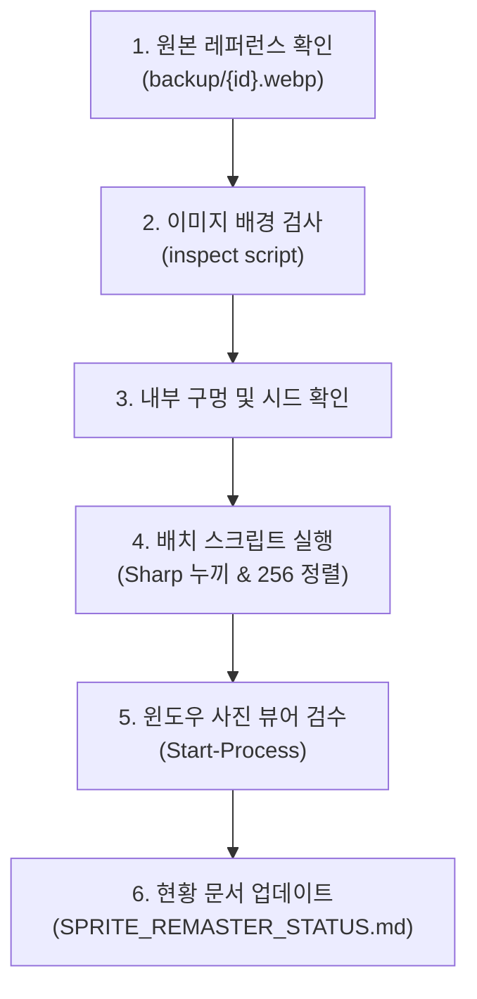

# 포켓몬 스프라이트 고화질 리마스터 작업 완벽 가이드 (Reference Manual)

이 문서는 게임 내 저해상도(`128×128`) 또는 여백 문제로 크기가 작은 포켓몬 2D 배틀 스프라이트를 **`256×256` 규격의 고화질 무손실 2D 배틀 스프라이트로 정밀 리마스터하고 적용하는 전체 프로세스**를 나중에도 동일하게 재현할 수 있도록 정리한 표준 지침서입니다.

---

## 1. 핵심 품질 원칙 (Strict Principles)

모든 리마스터 작업은 다음 4대 원칙을 예외 없이 따라야 합니다:

1. **철저한 2D 애니메이션 / 공식 도트·일러스트 그림체 준수**:
   - ⚠️ **3D 모델(Pokémon HOME 모델, 3D CGI 입체 렌더링) 절대 사용 금지**.
   - 선명하고 굵은 외곽선(Black Outline)과 셀 채색(Cel-shading)을 갖춘 2D 공식 배틀 스프라이트 스타일이어야 합니다.
2. **원본 배틀 자세(포즈/실루엣) 엄격 유지**:
   - AI가 자체적으로 자세를 재해석하거나 역동적으로 과장해서는 안 됩니다.
   - 반드시 원본 레퍼런스(`public/img/pokemon/backup/{id}.webp`)의 **바라보는 방향, 머리 각도, 팔다리 배치, 관절 꺾임, 실루엣**을 그대로 유지해야 합니다.
3. **누끼(투명화) 기준 및 해부학적 파츠 100% 보존**:
   - 외곽 배경은 물론, **몸통-날개-꼬리-팔다리 사이에 갇힌 내부 배경 구멍(Holes)**도 완전히 투명화해야 합니다.
   - ⚠️ **캐릭터의 신체 부위인 이빨, 눈 흰자위, 발톱, 구름 수염, 얼음 갑주, 종이 칼날 등 흰색/밝은 파츠는 절대 투명화되지 않고 온전히 보존**되어야 합니다.
4. **캔버스 규격 및 세로 정렬 기준**:
   - 캔버스 크기: `256×256` 픽셀, 포맷: 무손실 WebP (`.webp`)
   - 가로 정렬: 완벽한 중앙 정렬 (`leftPad = Math.round((256 - newW) / 2)`)
   - 세로 정렬 타입:
     - **접지형(Grounded)**: `bottomPad: 2px` (일반 포켓몬, 멜메탈, 견고라스 등 바닥에 서 있는 개체)
     - **미세 부유형(Slight Float)**: `bottomPad: 4~6px` (텅비드, 철화구야, 아고용 등 바닥에서 살짝 뜬 개체)
     - **완전 부유형(Floating/Centered)**: `topPad`와 `bottomPad` 균등 배분 (종이신도, 레지에레키 등 공중에 뜬 개체)

---

## 2. 체크무늬 배경 정밀 누끼 알고리즘

Gemini 또는 사용자가 업로드한 고화질 이미지는 투명 배경이 아닌 **밝은 회색/흰색 체크무늬(Checkerboard Mosaic)** 배경으로 들어옵니다.

### (1) 배경 판별 조건
체크무늬 배경은 **채도가 없고(중립색) 밝기가 높다**는 공통점이 있습니다:
```js
function isBgPixel(r, g, b) {
  const minC = Math.min(r, g, b);
  const maxC = Math.max(r, g, b);
  const diff = maxC - minC;
  // 중립 회색/흰색 판별 (이미지에 따라 minBgBrightness: 200~225, maxBgDiff: 8~12)
  return minC >= minBgBrightness && diff <= maxBgDiff;
}
```

### (2) 외곽 4면 플러드 필 (Border Flood Fill)
- 캔버스의 상/하/좌/우 4개 외곽 테두리에서 시작하는 BFS(너비 우선 탐색) 큐를 구성합니다.
- 캐릭터의 외곽선(`RGB < 80`)에 도달하면 플러드 필이 멈추므로, **내부의 흰색 신체 부위(Glastrier의 털, Pheromosa의 면사포 등)를 절대 침범하지 않습니다.**

### (3) 내부 갇힌 배경 구멍(Holes) 처리
- 날개 루프, 꼬리 루프, 다리 사이, 갈기 틈 등 외곽선으로 밀폐된 배경은 시드 좌표(`holeSeeds: [[x, y], ...]`)를 입력하여 동일한 BFS로 투명화합니다.

### (4) 디프린징(Defringing / Anti-Aliasing) 처리
- 게임 내 다크 모드/어두운 배틀 배경에서 흰색 잔상(Halos)이 남지 않도록, 외곽선 인접 픽셀에 대해 다음 보정을 적용합니다:
```js
if (hasBgNeighbor) {
  const minC = Math.min(r, g, b);
  const maxC = Math.max(r, g, b);
  const diff = maxC - minC;
  if (minC >= 150 && diff <= 22) {
    const alpha = Math.max(0, Math.min(255, Math.round(((230 - minC) / 80) * 255)));
    rgba[outIdx + 3] = alpha;
    const ratio = alpha / 255;
    // 어두운 외곽선 색상 [24, 25, 30]으로 색상 틴팅
    rgba[outIdx] = Math.round(r * ratio + 24 * (1 - ratio));
    rgba[outIdx + 1] = Math.round(g * ratio + 25 * (1 - ratio));
    rgba[outIdx + 2] = Math.round(b * ratio + 30 * (1 - ratio));
  }
}
```

### (5) 워터마크 및 미세 노이즈 제거
- 우측 하단 등에 남을 수 있는 100px 미만의 고립된 미세 패치(Gemini 워터마크 잔여물 등)는 Connected Component 크기 필터링으로 자동 제거합니다.

---

## 3. 작업 표준 실행 절차 (Step-by-Step Workflow)

새로운 스프라이트를 작업할 때는 아래 6단계를 그대로 따릅니다.



### Step 1. 원본 레퍼런스 확인
- `public/img/pokemon/backup/{id}.webp` 파일을 읽어 원본 배틀 실루엣, 접지 여부, 내부 구멍 여부를 확인합니다.

### Step 2. 이미지 배경 및 경계 검사
- `node` 한 줄 또는 임시 스크립트로 4면 외곽 밝기 및 최대 색상 차이를 측정합니다:
```js
// 테두리 최소 밝기 및 최대 색상 차이 확인
let minBrightness = 255, maxDiff = 0;
// sample 4 borders ...
// 보통 minBrightness: 215~235, maxDiff: 3~6 범위로 나옵니다.
```

### Step 3. 내부 갇힌 배경 구멍 파악
- 다리 사이, 날개 안쪽, 꼬리 루프 등이 닫혀 있는지 확인하고 필요 시 시드 좌표 `[x, y]`를 추출합니다.

### Step 4. 배치 스크립트 작성 및 실행
- 아래 표준 템플릿 코드(`scripts/process_user_batch.js`)에 대상 포켓몬 설정(경로, 여백, 시드)을 추가하고 실행합니다:
```powershell
node scripts/process_user_batch.js
```

### Step 5. 윈도우 사진 뷰어로 즉시 검수
- 생성된 PNG 미리보기를 팝업하여 사용자/작업자가 즉각 검수합니다:
```powershell
powershell -Command "Start-Process 'public\img\pokemon\test_{id}_ai.png'"
```

### Step 6. 현황 문서 업데이트
- `public/txt/md/SPRITE_REMASTER_STATUS.md` 문서에 완료 목록 및 잔여 목록을 갱신합니다.

---

## 4. 표준 처리 스크립트 템플릿 (Full Script Template)

```javascript
const fs = require('fs');
const path = require('path');
const sharp = require('sharp');

/**
 * 2D 포켓몬 스프라이트 고화질 무손실 정밀 누끼 및 256x256 규격화 함수
 */
async function processSprite(config) {
  const {
    inputPath,
    outputPath,
    previewPath,
    targetMaxW = 230,
    targetMaxH = 228,
    bottomPad = 2,
    minBgBrightness = 215,
    maxBgDiff = 10,
    holeSeeds = []
  } = config;

  console.log(`\n========================================`);
  console.log(`Processing: ${path.basename(outputPath)} from ${path.basename(inputPath)}`);

  const { data, info } = await sharp(inputPath).raw().toBuffer({ resolveWithObject: true });
  const w = info.width, h = info.height;

  function isBgPixel(r, g, b) {
    const minC = Math.min(r, g, b);
    const maxC = Math.max(r, g, b);
    return minC >= minBgBrightness && (maxC - minC) <= maxBgDiff;
  }

  // 1. 외곽 4면 플러드 필
  const isBg = new Uint8Array(w * h);
  const queue = [];

  function tryEnqueue(x, y) {
    const idx = y * w + x;
    if (!isBg[idx] && isBgPixel(data[idx * 3], data[idx * 3 + 1], data[idx * 3 + 2])) {
      isBg[idx] = 1;
      queue.push(x, y);
    }
  }

  for (let x = 0; x < w; x++) { tryEnqueue(x, 0); tryEnqueue(x, h - 1); }
  for (let y = 0; y < h; y++) { tryEnqueue(0, y); tryEnqueue(w - 1, y); }

  let head = 0;
  while (head < queue.length) {
    const cx = queue[head++];
    const cy = queue[head++];
    for (const [nx, ny] of [[cx-1, cy], [cx+1, cy], [cx, cy-1], [cx, cy+1]]) {
      if (nx >= 0 && nx < w && ny >= 0 && ny < h) {
        const nidx = ny * w + nx;
        if (!isBg[nidx] && isBgPixel(data[nidx * 3], data[nidx * 3 + 1], data[nidx * 3 + 2])) {
          isBg[nidx] = 1;
          queue.push(nx, ny);
        }
      }
    }
  }

  // 2. 검증된 내부 갇힌 배경 구멍 투명화
  for (const [sx, sy] of holeSeeds) {
    const sidx = sy * w + sx;
    if (!isBg[sidx] && isBgPixel(data[sidx * 3], data[sidx * 3 + 1], data[sidx * 3 + 2])) {
      const hQueue = [sx, sy];
      isBg[sidx] = 1;
      let hHead = 0;
      while (hHead < hQueue.length) {
        const hx = hQueue[hHead++];
        const hy = hQueue[hHead++];
        for (const [nhx, nhy] of [[hx-1, hy], [hx+1, hy], [hx, hy-1], [hx, hy+1]]) {
          if (nhx >= 0 && nhx < w && nhy >= 0 && nhy < h) {
            const nidx = nhy * w + nhx;
            if (!isBg[nidx] && isBgPixel(data[nidx * 3], data[nidx * 3 + 1], data[nidx * 3 + 2])) {
              isBg[nidx] = 1;
              hQueue.push(nhx, nhy);
            }
          }
        }
      }
    }
  }

  // 3. RGBA 버퍼 생성 및 디프린징(Anti-Aliasing)
  const rgba = Buffer.alloc(w * h * 4);
  for (let y = 0; y < h; y++) {
    for (let x = 0; x < w; x++) {
      const idx = (y * w + x) * 3;
      const outIdx = (y * w + x) * 4;
      const r = data[idx], g = data[idx + 1], b = data[idx + 2];
      rgba[outIdx] = r;
      rgba[outIdx + 1] = g;
      rgba[outIdx + 2] = b;

      if (isBg[y * w + x]) {
        rgba[outIdx + 3] = 0;
      } else {
        let hasBgNeighbor = false;
        for (const [nx, ny] of [[x-1, y], [x+1, y], [x, y-1], [x, y+1]]) {
          if (nx >= 0 && nx < w && ny >= 0 && ny < h && isBg[ny * w + nx]) {
            hasBgNeighbor = true;
            break;
          }
        }

        if (hasBgNeighbor) {
          const minC = Math.min(r, g, b);
          const maxC = Math.max(r, g, b);
          const diff = maxC - minC;
          if (minC >= 150 && diff <= 22) {
            const alpha = Math.max(0, Math.min(255, Math.round(((230 - minC) / 80) * 255)));
            rgba[outIdx + 3] = alpha;
            const ratio = alpha / 255;
            rgba[outIdx] = Math.round(r * ratio + 24 * (1 - ratio));
            rgba[outIdx + 1] = Math.round(g * ratio + 25 * (1 - ratio));
            rgba[outIdx + 2] = Math.round(b * ratio + 30 * (1 - ratio));
          } else {
            rgba[outIdx + 3] = 255;
          }
        } else {
          rgba[outIdx + 3] = 255;
        }
      }
    }
  }

  // 4. 고립된 100px 미만 잔여 노이즈/워터마크 제거
  const speckleVisited = new Uint8Array(w * h);
  for (let y = 0; y < h; y++) {
    for (let x = 0; x < w; x++) {
      const idx = y * w + x;
      if (!speckleVisited[idx] && rgba[idx * 4 + 3] > 0) {
        const patch = [];
        const q = [x, y];
        speckleVisited[idx] = 1;
        let qh = 0;
        while (qh < q.length) {
          const cx = q[qh++], cy = q[qh++];
          patch.push(cy * w + cx);
          for (const [nx, ny] of [[cx-1, cy], [cx+1, cy], [cx, cy-1], [cx, cy+1]]) {
            if (nx >= 0 && nx < w && ny >= 0 && ny < h) {
              const nidx = ny * w + nx;
              if (!speckleVisited[nidx] && rgba[nidx * 4 + 3] > 0) {
                speckleVisited[nidx] = 1;
                q.push(nx, ny);
              }
            }
          }
        }
        if (patch.length < 100) {
          for (const p of patch) rgba[p * 4 + 3] = 0;
        }
      }
    }
  }

  // 5. 투명 여백 트림
  const rawPng = await sharp(rgba, { raw: { width: w, height: h, channels: 4 } }).png().toBuffer();
  const trimmed = await sharp(rawPng).trim().toBuffer({ resolveWithObject: true });
  const trimW = trimmed.info.width;
  const trimH = trimmed.info.height;

  // 6. 256x256 비율에 맞게 리사이징
  let scale = 1.0;
  if (trimW > targetMaxW) scale = targetMaxW / trimW;
  if (trimH * scale > targetMaxH) scale = targetMaxH / trimH;

  const newW = Math.round(trimW * scale);
  const newH = Math.round(trimH * scale);

  const resized = await sharp(trimmed.data)
    .resize(newW, newH, { kernel: sharp.kernel.lanczos3 })
    .toBuffer();

  const topPad = Math.max(0, 256 - newH - bottomPad);
  const leftPad = Math.max(0, Math.round((256 - newW) / 2));

  // 7. 256x256 투명 캔버스에 합성 및 무손실 WebP 저장
  const finalCanvas = await sharp({
    create: {
      width: 256,
      height: 256,
      channels: 4,
      background: { r: 0, g: 0, b: 0, alpha: 0 }
    }
  }).composite([{ input: resized, top: topPad, left: leftPad }]);

  const webpBuffer = await finalCanvas.webp({ lossless: true }).toBuffer();
  fs.writeFileSync(outputPath, webpBuffer);

  if (previewPath) {
    const pngBuffer = await sharp(webpBuffer).png().toBuffer();
    fs.writeFileSync(previewPath, pngBuffer);
  }

  return { width: newW, height: newH, topPad, leftPad };
}
```

---

## 5. 포켓몬별 파라미터 및 주요 성공 사례

| 포켓몬 | ID | 배치 방식 | 패딩 (Padding) | 주요 조치 및 구멍(Holes) |
| :--- | :--- | :--- | :--- | :--- |
| **메가보만다** | `0373-m` | 접지 | `bottomPad: 2px` | 초승달 날개 거대 루프(33,000px) 내부 구멍 시드 투명화 |
| **메가한카리아스**| `0445-m` | 접지 | `bottomPad: 2px` | 우측 낫-팔 안쪽 루프(4,437px) 내부 구멍 시드 투명화 |
| **랜드로스(영물)**| `0645-a` | 접지 | `bottomPad: 2px` | 물음표 꼬리 루프 안쪽 누끼(16,825px) 투명화, 구름 수염 100% 보존 |
| **어래곤** | `0882` | 접지 | `bottomPad: 2px` | 귀 지느러미 안쪽 구멍 투명화, 초승달 눈/이마 보존 |
| **카푸꼬꼬꼭** | `0785` | 접지 | `bottomPad: 2px` | 껍질 삼각형 및 날개 다이아몬드 엠블럼 보존 (구멍 없음) |
| **텅비드** | `0793` | 미세 부유 | `bottomPad: 6px` | 촉수 사이 외곽 투명화, 해파리 반투명 감각 유지 |
| **페로코체** | `0795` | 접지 슬림 | `bottomPad: 2px` | 순백색 신체/면사포/더듬이 100% 보존 (`139×216`) |
| **철화구야** | `0797` | 미세 부유 | `bottomPad: 4px` | 대나무 팔 사이 배경 완벽 투명화, 광폭 정렬 (`236×207`) |
| **종이신도** | `0798` | 완전 부유 | `topPad: 59px` | 순백색 종이 블레이드 보존, 수직 중앙 부유 정렬 (`228×143`) |
| **아고용** | `0804` | 미세 부유 | `bottomPad: 4px` | 날개·독침 실루엣 보존, 부유감 유지 (`220×226`) |
| **멜메탈** | `0809` | 접지 광폭 | `bottomPad: 2px` | 배 너트 내부 음영 보존, 액체 금속 하이라이트 보존 (`236×151`) |
| **백마 버드렉스**| `0898-a` | 접지 | `bottomPad: 2px` | 블리자포스 순백색 털/얼음 갑주 100% 보존 (`112×228`) |
| **흑마 버드렉스**| `0898-b` | 접지 | `bottomPad: 2px` | 다리-갈기 사이 안쪽 갇힌 누끼 2개소(592px) 정밀 투명화 (`133×228`) |

---

## 6. 현황 및 문서 관리 규칙 (Documentation Rules)

1. 앞으로 **모든 마크다운(`.md`) 파일은 반드시 `public/txt/md/` 폴더 내에 생성 및 보관**합니다.
2. 각 포켓몬의 최신 리마스터 완료/잔여 목록은 `public/txt/md/SPRITE_REMASTER_STATUS.md`를 통해 추적 및 업데이트합니다.
3. 작업 완료 후에는 다음 작업자가 이어받을 수 있도록 잔여 포켓몬 목록(현재 6종: `0555-g`, `0598`, `0649`, `0697`, `0716`, `0717`)을 명시합니다.
